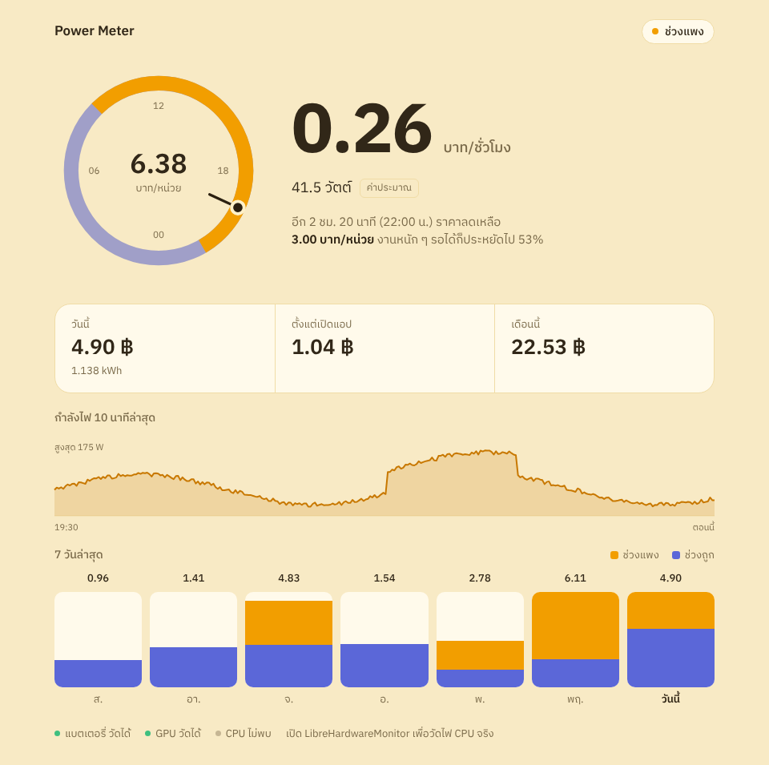

# power-meter

วัดว่าคอมใช้ไฟไปเท่าไหร่ แล้วคิดเป็นเงินบาทตามค่าไฟจริงของไทย รองรับทั้งมิเตอร์ปกติและมิเตอร์ TOU (กลางวันแพง กลางคืนถูก)

*Track how much electricity your PC uses and what it costs in Thai baht, including time-of-use (TOU) pricing.*

```
21:30:05 Peak     ประมาณ   98.4 W  0.63 ฿/ชม. | รอบนี้  1.204 ฿ | วันนี้ 0.512 kWh   2.87 ฿ | รวม   41.20 ฿
```

## ติดตั้ง

ต้องใช้ Windows และ Python 3.11 ขึ้นไป

```
git clone https://github.com/Tachsakorn/power-meter
cd power-meter
pip install .
```

ไม่ต้องตั้งค่าอะไร และไม่ต้องใช้สิทธิ์ admin แอปตรวจเองทั้งหมด:

- คอมตั้งโต๊ะหรือโน้ตบุ๊ก, รุ่น CPU, การ์ดจอ, จำนวน RAM และไดรฟ์
- ค่า Ft ตามวันที่ และอัปเดตอัตราค่าไฟเองจาก `rates.json` ใน repo นี้
- วันหยุดราชการไทย

อย่างเดียวที่ถามคือบ้านใช้มิเตอร์ปกติหรือ TOU (ถามครั้งเดียวในแอป เปลี่ยนทีหลังได้)

## ใช้งาน

ดับเบิลคลิก `run.bat` เพื่อเปิดแอป ครั้งแรกจะติดตั้งสิ่งที่ต้องใช้ให้เอง



หน้าแอปเปลี่ยนสีตามช่วงค่าไฟ: สีแดดตอนช่วงแพง สีกลางคืนตอนช่วงถูก วงกลมคือนาฬิกา 24 ชั่วโมงที่บอกว่าช่วงไหนแพงหรือถูก และเข็มชี้เวลาตอนนี้

ใช้ผ่าน command line ก็ได้:

```
power-meter              # เปิดแอป
power-meter run          # วัดในหน้าต่าง console กด Ctrl+C เพื่อหยุด
power-meter report       # ดูสรุป 7 วันล่าสุด
power-meter report -d 30
```

ข้อมูลเก็บไว้ที่ `%LOCALAPPDATA%\power-meter\usage.json` ปิดแล้วเปิดใหม่ก็นับต่อจากเดิม

## เกม Build Your Reactor (ไม่บังคับ)

กดแท็บ **Build Your Reactor** บนหัวแอปเพื่อเล่นเกมสร้างโรงไฟฟ้าแบบ idle สร้างไดนาโม แผงโซลาร์ กังหันลม ห้องแล็บ แบตเตอรี่ ไปจนถึงเตาฟิชชันและฟิวชัน

- เกมแยกขาดจากมิเตอร์ ใช้เครดิตสมมติ (cr) ไม่ใช่เงินจริง และไม่ได้คิดจากไฟที่คอมใช้
- ค่าไฟจริง (฿/ชม.) ยังโชว์อยู่บนหัวหน้าเกม การวัดไฟทำงานต่อตลอดแม้เปิดเกมอยู่
- ภาพเคลื่อนไหวจะหยุดเมื่อไม่ได้เปิดแท็บเกม เกมจะได้ไม่กินไฟเอง
- เซฟอยู่ที่ `%LOCALAPPDATA%\power-meter\reactor-save.json` แยกจากข้อมูลค่าไฟ

## วัดยังไง

| ส่วน | วิธี | ความแม่น |
|---|---|---|
| แบตเตอรี่ (โน้ตบุ๊ก) | อัตราคายไฟจาก driver ของแบต | แม่นที่สุด ตอนถอดปลั๊ก |
| การ์ดจอ NVIDIA | NVML จาก driver | วัดจริง |
| การ์ดจอ AMD | ADL จาก driver Radeon | วัดจริง |
| การ์ดจออื่น ๆ | % การใช้งาน (ตัวเดียวกับ Task Manager) × กำลังไฟของรุ่น | ประมาณ |
| CPU | % การใช้งาน × กำลังไฟของรุ่น | ประมาณ |
| เมนบอร์ด, RAM, ไดรฟ์, พัดลม | คิดจากชิ้นส่วนที่ตรวจเจอ | ประมาณ |

ไฟ CPU วัดตรง ๆ ไม่ได้ถ้าไม่มีสิทธิ์ admin ถ้าอยากได้ค่าจริง เปิด [LibreHardwareMonitor](https://github.com/LibreHardwareMonitor/LibreHardwareMonitor) แบบ admin แล้วกด **Options → Remote Web Server → Run** (ไม่บังคับ)

กด **ที่มาของตัวเลข** ในแอป หรือรัน `power-meter check` เพื่อดูว่าตรวจเจออะไรบ้าง

## ค่าไฟ

ค่าเริ่มต้นเป็นอัตราบ้านอยู่อาศัยของ กฟน./กฟภ. งวด ก.ย.–ธ.ค. 2569

- TOU Peak (จ–ศ 09:00–22:00): 5.7982 ฿ + Ft
- TOU Off-peak (นอกเวลาด้านบน, ส–อา, วันหยุดราชการ): 2.6369 ฿ + Ft
- Ft = 0.1623 ฿/หน่วย, VAT 7%

ค่า Ft เปลี่ยนทุก 4 เดือน แอปเลือกค่าตามวันที่เอง และดาวน์โหลด `rates.json` ล่าสุดจาก repo นี้ตอนเปิดแอป ผู้ดูแลแค่แก้ไฟล์นี้ไฟล์เดียว ทุกเครื่องได้ค่าใหม่ ค่าไฟของวันที่บันทึกไปแล้วยังคิดตามราคาเดิม

## พัฒนา

```
pip install -e ".[dev]"
pytest
power-meter check
node --test tests/js/*.test.js
ruff check . && ruff format .
```

## ข้อจำกัด

- ตอนนี้รองรับเฉพาะ Windows
- คอมตั้งโต๊ะวัดไฟทั้งเครื่องด้วยซอฟต์แวร์ไม่ได้ ตัวเลขรวมจึงเป็นค่าประมาณ ไม่รวมจอ
- ไดรเวอร์ของ LibreHardwareMonitor อาจโดน Windows Defender เตือน

## License

MIT. ฟอนต์ IBM Plex Sans Thai และ Mali ใช้ SIL Open Font License (ดู `OFL.txt` ในโฟลเดอร์ `fonts`)
